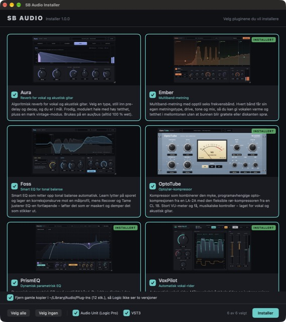

# SB Audio

Audio Unit- og VST3-plugins for Logic Pro.

| Plugin | Hva den gjør |
|---|---|
| [VoxPilot](plugins/VoxPilot/README.md) | Automatisk vokal-rider |
| [PrismEQ](plugins/PrismEQ/README.md) | Dynamisk parametrisk EQ (à la Pro-Q) for vokal og akustisk gitar |
| [OptoTube](plugins/OptoTube/README.md) | Opto/rør-kompressor (LA-2A møter CL 1B) for vokal og akustisk gitar |
| [Ember](plugins/Ember/README.md) | Multiband-metning (à la Saturn) med vokal-presets |
| [Aura](plugins/Aura/README.md) | Enkel reverb for vokal og akustisk gitar (hall, plate, rom, kammer, vintage) |
| [Foss](plugins/Foss/README.md) | Smart EQ for tonal balanse: Learn mot målprofil (à la smart:EQ) + adaptiv Recover/Tame (à la Gullfoss) |

## Bygge på Mac

Krav: macOS 11+, Xcode Command Line Tools (`xcode-select --install`) og CMake (`brew install cmake`).

```bash
scripts/build.sh VoxPilot      # én plugin
scripts/build.sh --all         # alle
```

Skriptet laster ned JUCE 8 automatisk (første gang), bygger universelle AU/VST3 (Apple Silicon + Intel),
installerer i `~/Library/Audio/Plug-Ins/`, ad-hoc-signerer, kjører `auval` og legger kopier i `dist/`.
Start Logic på nytt etterpå.

### Grafisk installasjonsprogram

```bash
scripts/build.sh --all
scripts/make-installer-app.sh      # -> dist/SBAudio-<versjon>.dmg
```



Diskbildet inneholder **SB Audio Installer.app**. Appen viser alle plugins som kort med et bilde og en kort
beskrivelse. Klikk på et kort for å velge det bort eller inn, velg AU og/eller VST3 nederst og trykk **Installer**.
Plugins som allerede er installert, får merket *INSTALLERT*. Appen ber om administratorpassord og installerer i
`/Library/Audio/Plug-Ins`. Den kan også fjerne gamle kopier i `~/Library/Audio/Plug-Ins` fra `scripts/build.sh`.

Kortene bygges av `plugins/<Navn>/docs/screenshot.png` (bildet) og `plugins/<Navn>/docs/installer.txt` (2–3 setninger).
Undertittelen hentes fra første linje i pluginens `README.md`. Kildekoden ligger i `installer/SBAudioInstaller.swift`.

Appen er ad-hoc-signert. Første gang: høyreklikk › **Åpne**. Den kan også åpnes via **Systeminnstillinger › Personvern og
sikkerhet › Åpne likevel**. Med en Developer ID: `SBAUDIO_APP_IDENTITY="Developer ID Application: …" scripts/make-installer-app.sh`.

### Installasjonspakke (.pkg)

```bash
scripts/build.sh --all
scripts/make-installer.sh          # -> dist/SBAudio-<versjon>.pkg
```

Pakken installerer for alle brukere: AU i `/Library/Audio/Plug-Ins/Components`, VST3 i
`/Library/Audio/Plug-Ins/VST3`. Installasjonsprogrammet viser alltid en liste der brukeren krysser av hvilke plugins
som skal installeres, og kan åpne hver plugin for å velge bort AU eller VST3.
Installasjonen krever administratorpassord.

Pakken er ikke signert med Apple Developer ID. Da stopper macOS den første gang den åpnes. Gå til
**Systeminnstillinger › Personvern og sikkerhet**, bla ned og trykk **Åpne likevel**. Med en Developer ID kan pakken
signeres: `SBAUDIO_INSTALLER_IDENTITY="Developer ID Installer: …" scripts/make-installer.sh`.

Har du installert med `scripts/build.sh`, ligger det også kopier i `~/Library/Audio/Plug-Ins`. Slett dem der, så Logic
ikke finner to versjoner.

### GitHub

Workflowen `.github/workflows/build-macos.yml` bygger og validerer alle plugins ved hver push og legger dem ved
som nedlastbare artefakter: `SBAudio-Installer-App` (diskbilde med installasjonsappen), `SBAudio-Installer` (pakken) og `SBAudio-macOS` (løse plugins). For løse plugins, etter nedlasting: `xattr -dr com.apple.quarantine <Plugin>.component` før du kopierer
den til `~/Library/Audio/Plug-Ins/Components/`.

JUCE er lisensiert under AGPLv3 / JUCE-lisens (gratis for personlig bruk under omsetningsgrensen).
