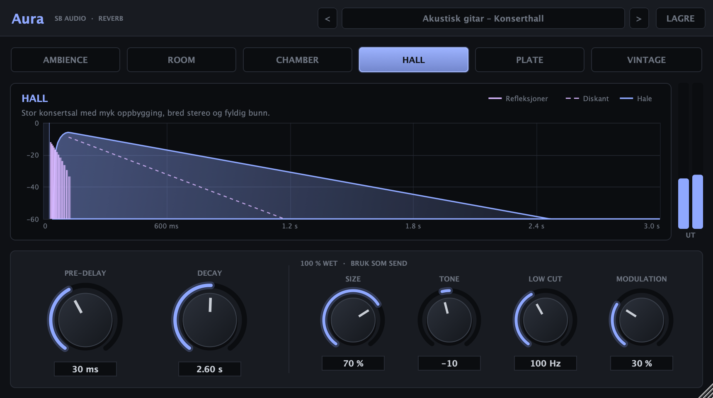

# Aura – reverb for vokal og akustisk gitar

Aura er en Audio Unit / VST3-reverb laget for vokal og akustisk gitar. Den er laget for å være rask å bruke:
velg en type, still inn **Pre-delay** og **Decay**, og du er i mål. Fire ekstra kontroller finjusterer lyden.

Aura er alltid **100 % wet** og har ingen Mix-knapp. Bruk den på en aux/bus og send til den fra sporene
(se *Bruk i Logic Pro* under).

Ideen bak: et moderne, algoritmisk reverb med få kontroller (som Waves Atlas), med frodig, modulert hale og høy
tetthet (som Valhalla-reverbene) og en mørk, mellomtonefyldig vintage-modus inspirert av tidlige digitale
reverber som EMT 244.



## Typer

| Type | Karakter | Passer til |
|---|---|---|
| **Ambience** | Kort, tett rom uten tydelig hale. Gir nærhet og luft uten at det høres ut som reverb. | Rap, tale, tørr pop-vokal, nær gitar |
| **Room** | Naturlig rom med tydelige tidlige refleksjoner. | Gitar i et rom, naturlig vokal |
| **Chamber** | Ekkokammer: tett og jevn, varmere enn en hall. | Vokal, bakgrunnsvokal, gitar |
| **Hall** | Stor konsertsal med myk oppbygging, bred stereo og fyldig bunn. | Ballader, fingerspill, svevende lyder |
| **Plate** | Umiddelbar, tett og lys, uten tidlige refleksjoner. Legger seg pent bak vokalen. | Klassisk vokal-reverb, strumming |
| **Vintage** | Tidlig digital 80-tallsreverb: mørk, mellomtonefyldig og litt kornete, med tydelig modulasjon. | Vokal med karakter, retro-lyd |

Bytter du type, toner reverben mykt ut og inn igjen, så det ikke klikker.

## Kontroller

| Kontroll | Hva den gjør |
|---|---|
| **Pre-delay** | Tid før reverben starter (0–250 ms). 20–80 ms holder vokalen tydelig foran reverben. |
| **Decay** | Hvor lang tid det tar før reverben har dødd ut, målt i sekunder (RT60, 0,2–20 s). |
| **Size** | Romstørrelse: avstanden mellom refleksjonene og hvor tett halen er. Liten = tett, stor = åpen. |
| **Tone** | Mørkere (−) eller lysere (+) reverb. Styrer både diskanten inn og hvor fort diskanten dør ut. |
| **Low Cut** | Fjerner bunn fra reverben (20–600 Hz), så miksen ikke blir grøtete. 100–250 Hz er vanlig på vokal. |
| **Modulation** | Svak chorus i halen. Gjør reverben bredere og mykere, uten metallisk ring. |

Grafen viser reverben over tid:

- Det skraverte feltet til venstre er pre-delay.
- De lilla strekene er de tidlige refleksjonene.
- Den blå flaten er halen.
- Den stiplede linjen viser hvor fort diskanten dør ut.

Dobbeltklikk på en knapp for å sette den tilbake til standard. Vinduet kan skaleres fra hjørnet nede til høyre.

## Presets

Velg i menyen øverst (eller bla med `<` `>`). Fabrikkpresetene vises også i Logics egen preset-meny.

- **Vokal:** Plate klassisk · Plate lys pop · Plate lang ballade · Vintage 80-tall · Vintage mørk og tett ·
  Hall moderne pop · Hall stor ballade · Episk hale · Kammer varm · Kammer bred bakgrunnsvokal · Rom naturlig ·
  Rom med pre-delay · Ambience nærhet · Rap og tale tørr
- **Akustisk gitar:** Rom treverk · Nær ambience · Kammer · Konserthall · Fingerspill stor hall · Plate glans ·
  Strumming kort plate · Vintage plate · Svevende ambient

**Egne presets:** trykk **LAGRE** og gi et navn. De lagres i `~/Library/Audio/Presets/SB Audio/Aura/`.

## Bruk i Logic Pro

1. Lag en aux: velg sporet, og under **Sends** velger du en ledig bus (f.eks. *Bus 1*). Logic lager en aux-kanal.
2. Sett **Aura** som insert på aux-kanalen (*Audio Units → SB Audio → Aura*).
3. Velg en preset, og skru opp send-nivået på sporet til reverben ligger der du vil ha den.
4. Juster **Decay** etter tempoet og **Pre-delay** etter hvor tydelig vokalen skal stå. Mengden reverb styrer du
   med send-nivået og fadere på aux-kanalen.

Flere spor kan sende til samme Aura. Det gir et felles rom og sparer CPU.

Vil du bruke Aura direkte som insert på et spor, må du blande inn tørt signal på annen måte, fordi Aura alltid er
100 % wet.

## Bygge på Mac

Fra rotmappen (`SBAudio/`):

```bash
scripts/build.sh Aura
```

Se rotens `README.md` for krav og detaljer.

## Teknisk

- Feedback delay network med 8 linjer og Hadamard-matrise, og fire allpass-diffusorer per kanal på inngangen.
- Hver linje har en allpass inne i sløyfen, som gir høy ekkotetthet.
- Modulerte forsinkelseslinjer med Hermite-interpolasjon gir en jevn, chorus-aktig hale.
- Etterklangstiden styres i tre bånd: bunn, mellomtone og diskant har hver sin RT60.
- Tidlige refleksjoner er et flertapp-mønster per type som skaleres med Size.
- Pre-delay krysstoner mellom to lesehoder ved endring, så den kan automatiseres uten klikk og pitch-svinger.
- Nivået er kalibrert, så typene ligger innenfor ca. ±2 dB av hverandre.
- Ingen latens. Mono inn → stereo ut støttes.
- CPU: ca. 1 % av én kjerne (Apple Silicon, stereo, 48 kHz).
- Målt etterklangstid følger Decay, og pluginen er stabil helt opp til 20 s.
- Kilde: `Source/ReverbEngine.h` (DSP), `Source/PluginProcessor.*` (parametere), `Source/PluginEditor.*` (GUI),
  `Source/FactoryPresets.h` (presets).

Waves, Atlas, Valhalla og EMT er varemerker for sine respektive eiere. Aura er en egen konstruksjon og ingen kopi
eller modellering av noe bestemt produkt.

JUCE er lisensiert under AGPLv3 / JUCE-lisens (gratis for personlig bruk under omsetningsgrensen).
