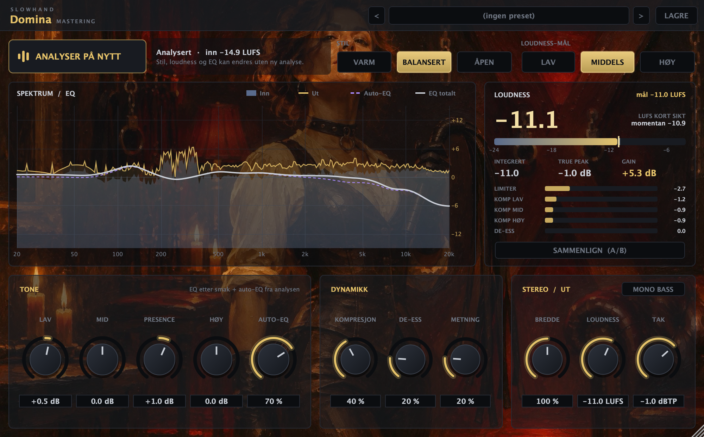

# Domina – smart mastering

Domina er en Audio Unit / VST3-plugin for mastering i Logic Pro, med samme arbeidsmåte som LANDRs mastering-plugin.
Du spiller av låta, og Domina **lytter** på den. Deretter setter den EQ, kompresjon og gain selv, slik at masteren treffer
loudness-målet du har valgt. Toppene går aldri over taket. Resultatet former du med noen få musikalske valg:
**stil** (Varm / Balansert / Åpen), **loudness** (Lav / Middels / Høy) og en håndfull knapper for tone, dynamikk og
stereo.



## Kom i gang

1. Sett **Domina** som *siste* insert på stereo-outputen (eller på en bus med hele miksen):
   *Audio Units → SLOWHAND → Domina*.
2. Spill av den **kraftigste delen** av låta, f.eks. refrenget. Første gang starter analysen av seg selv. Senere
   trykker du **ANALYSER**. Domina lytter i ca. 8 sekunder og finjusterer deretter i 2 × 3 sekunder. Pauser telles
   ikke med.
3. Velg **STIL** og **LOUDNESS-MÅL**. Begge kan endres når som helst uten ny analyse. Gain regnes ut på nytt med en
   gang.
4. Bruk **SAMMENLIGN (A/B)** for å høre originalen med *samme loudness* som masteren. Da hører du forskjellen i klang,
   ikke bare at masteren er høyere.
5. Juster eventuelt **Tone**, **Dynamikk** og **Stereo / Ut** etter smak, eller velg en preset for sjangeren.

Analysen lagres i Logic-prosjektet. Presets endrer ikke analysen, så loudness-målet holder også etter et preset-bytte.

## Kontroller

### Analyse, stil og loudness

| Kontroll | Hva den gjør |
|---|---|
| **ANALYSER** | Lytter på låta: 1/3-oktavspekter, mid/side-balanse og integrert loudness (ITU BS.1770). Lager auto-EQ, setter tersklene i kompressoren og gain mot målet. Til slutt lytter den på resultatet og retter opp avviket. Klikk under analysen for å avbryte. |
| **Stil** | *Varm*: litt mer bunn og mindre topp, roligere kompresjon og limiter, mer 2. harmoniske. *Balansert*: nøytral. *Åpen*: mer topp og luft, raskere tider, renere metning. |
| **Loudness-mål** | *Lav* = −14 LUFS (strømming), *Middels* = −11 LUFS, *Høy* = −8 LUFS. Fin-justeres med **Loudness**-knappen (−18 til −6 LUFS). |

### Tone

| Kontroll | Hva den gjør |
|---|---|
| **Lav / Mid / Presence / Høy** | Musikalsk EQ: hylle 100 Hz, klokke 900 Hz, klokke 4 kHz og hylle 9 kHz (±6 dB). |
| **Auto-EQ** | Hvor mye av korreksjonen fra analysen som brukes (lilla stiplet kurve i grafen). Domina sammenligner miksen med en målkurve for ferdig mastret musikk. Kurven er vippet etter stil. Korreksjonen er bevisst forsiktig (maks +4 / −6 dB) og løfter aldri under 35 Hz. |

### Dynamikk

| Kontroll | Hva den gjør |
|---|---|
| **Kompresjon** | 3-bånds kompressor (delefrekvenser 160 Hz og 2,5 kHz, Linkwitz-Riley) som limer miksen sammen. Terskelen følger nivået i hvert bånd fra analysen, og ratio går fra 1:1 til 4:1. Make-up holder loudness omtrent uendret. |
| **De-ess** | Dynamisk klokke på 7,5 kHz som bare demper når S-lyder og cymbaler stikker ut av resten av miksen. |
| **Metning** | Myk bånd-/rørkarakter like før limiteren, 4× oversamplet. Gir tetthet og runder av toppene, så limiteren jobber mindre. |

### Stereo / ut

| Kontroll | Hva den gjør |
|---|---|
| **Bredde** | Sidesignalet fra 0 % (mono) til 200 %. 100 % = uendret. |
| **Mono bass** | Gjør alt under ca. 120 Hz mono. Gir strammere bunn og passer for vinyl og klubb. |
| **Loudness** | Loudness-målet i LUFS. |
| **Tak** | Høyeste tillatte topp (true peak), −3 til 0 dBTP. −1 dBTP er trygt for strømmetjenester. |

### Visning

- **Spektrum / EQ**: spektrum inn (grå) og ut (gull), auto-EQ (lilla) og total EQ-kurve (hvit). Spekteret er
  vippet +3 dB/oktav, så en balansert miks ser omtrent flat ut.
- **Loudness**: kortsiktig loudness (3 s) som stort tall, momentan loudness, en stolpe med målet markert, integrert
  loudness, true peak og gain. Under ligger gain reduction for limiter, de tre kompressorbåndene og de-esseren.
  Klikk på panelet for å nullstille integrert loudness og true peak. De nullstilles også når en analyse er ferdig.

## Bygge på Mac

Fra rotmappen (`SBAudio/`):

```bash
scripts/build.sh Domina
```

Se rotens `README.md` for krav og detaljer. Hvis Logic ikke viser pluginen:
*Logic Pro → Settings → Plug-in Manager → Reset & Rescan Selection*.

## Teknisk

- Signalvei: auto-EQ (10 filtre) → tone-EQ → 3-bånds kompressor → de-esser → bredde (M/S) → gain →
  [4× oversampling: metning → lookahead-limiter → tak] → nivåmatchet A/B.
- Limiteren har 1 ms lookahead, glidende minimum og boksutjevning, så den aldri overskyter. Den kjører 4× oversamplet,
  så taket gjelder true peak. Release følger stilen (80–180 ms).
- Latens: ca. 2 ms (1 ms lookahead + oversamplingsfiltre), rapportert til verten. Logic kompenserer automatisk.
  A/B-originalen forsinkes like mye, så det ikke hopper i tid.
- Loudness-målet nås slik: gain = mål − (loudness inn + EQ-endring + breddeendring) + rest. EQ- og breddeendringen
  regnes ut fra det analyserte spekteret, så gain følger med når du skrur. Resten måles i to omganger på det ferdige
  signalet, fordi limiteren «spiser» noe av hver gain-økning. Målt på testsignal treffer den målet innenfor ca. ±0,3 LU.
- Kilde: `Source/MasteringEngine.h` (DSP og analyse), `Source/PluginProcessor.*` (parametere, lagring),
  `Source/PluginEditor.*` (GUI), `Source/FactoryPresets.h` (sjanger-presets).

JUCE er lisensiert under AGPLv3 / JUCE-lisens (gratis for personlig bruk under omsetningsgrensen).
