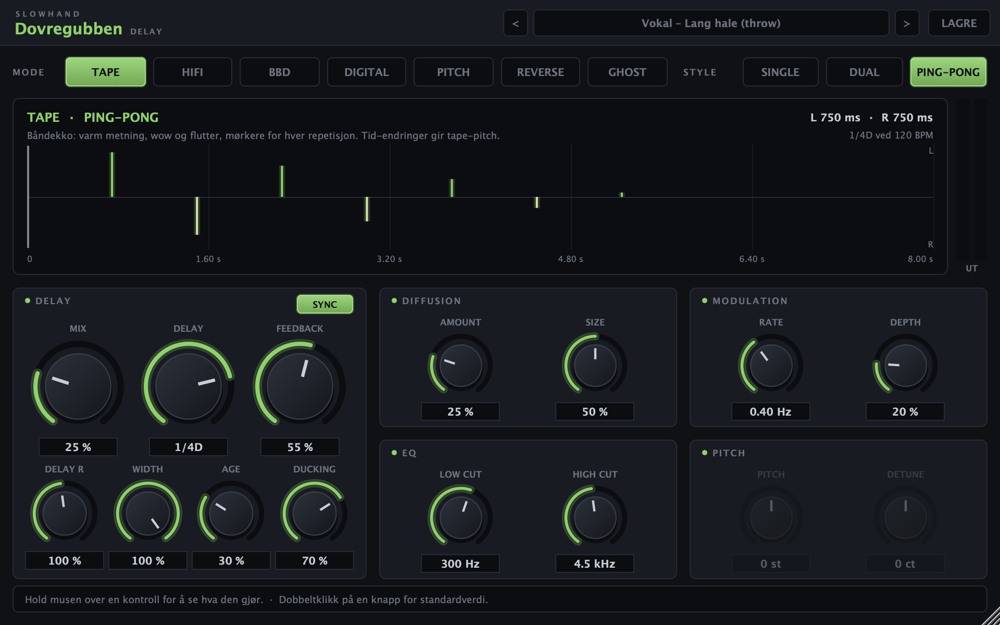

# Dovregubben – karakter-delay

Dovregubben er en Audio Unit / VST3-delay med sju moduser, fra varmt båndekko og mørk analog BBD til ren digital,
pitch-shift, baklengs og spøkelsesaktige frekvensskift-ekko. Den er laget etter samme idé som Valhalla Delay:
én delay med mange karakterer, der alt etter selve forsinkelsen (EQ, metning, diffusjon og pitch) ligger inne i
feedback-sløyfen, så hver repetisjon endrer seg.

Grensesnittet følger de andre SLOWHAND-pluginene: modusknapper øverst, en graf som viser ekkomønsteret, knapper
gruppert i DELAY, DIFFUSION, MODULATION, EQ og PITCH, og en infolinje nederst som forklarer kontrollen du holder
musen over.



## Moduser

| Mode | Karakter | AGE gjør |
|---|---|---|
| **Tape** | Båndekko: varm metning, wow og flutter, mørkere for hver repetisjon. Endrer du tiden, glir pitchen som på en båndmaskin. | Mer metning, mørkere, mer wow/flutter og litt sus |
| **HiFi** | Moderne, ren og lys delay med litt mykhet i sløyfen. | Litt varme og mindre diskant |
| **BBD** | Analog «bucket brigade»-delay: smal båndbredde, mørk og myk. | Mørkere og mer skitten, litt støy |
| **Digital** | Helt ren digital delay. | Lavere bitdybde og samplerate (tidlig digital lyd) |
| **Pitch** | Pitch-shifter i sløyfen. **DETUNE** stemmer venstre opp og høyre ned (dobling), **PITCH** transponerer hver repetisjon. | Mørkere |
| **Reverse** | Spiller bitene baklengs. **DELAY** bestemmer lengden på hver bit. | Mørkere |
| **Ghost** | Frekvensskift og diffusjon i sløyfen: svevende, spøkelsesaktige ekko. **PITCH/DETUNE** styrer skiftet. | Mørkere |

## Style

| Style | Hva den gjør |
|---|---|
| **Single** | Ett ekko i midten (mono). |
| **Dual** | To uavhengige ekko, venstre og høyre, med hver sin tid (**DELAY** og **DELAY R**). Brukes til dobling og bredde. |
| **Ping-Pong** | Ekkoene hopper mellom venstre og høyre. |

## Kontroller

| Kontroll | Hva den gjør |
|---|---|
| **Mix** | Tørt mot ekko. 50 % = begge fullt. Bruk 100 % når Dovregubben står på en aux (send). |
| **Delay** | Tiden til første ekko, 1 ms–4 s. Med **SYNC** på velger du notelengde (1/64–1/1, triol T og punktert D) i takt med Logic. |
| **Feedback** | Hvor mye av ekkoet som går tilbake. 0 % = ett ekko (dobling), 30–50 % = flere repetisjoner, 90 %+ = nesten uendelig. |
| **Delay R** | Høyre kanals tid i prosent av venstre (10–200 %). Brukes i Dual og Ping-Pong. |
| **Width** | Stereobredden på ekkoene. |
| **Age** | Slitasje og karakter – se tabellen over. |
| **Ducking** | Demper ekkoene mens du synger/spiller og slipper dem fram i pausene. |
| **Diffusion Amount / Size** | Smører ut ekkoene, fra tydelige repetisjoner til en myk, reverb-aktig vask. Size er hvor lang tid utsmøringen tar. |
| **Mod Rate / Depth** | Modulasjon av delaytiden. Litt gjør doblinger og ekko levende og brede. |
| **Low Cut / High Cut** | EQ inne i sløyfen: hver repetisjon blir tynnere og mørkere. |
| **Pitch / Detune** | Pitch: ±12 halvtoner per repetisjon. Detune: ±50 cent, venstre opp og høyre ned. Brukes i Pitch og Ghost. |

Grafen viser ekkoene over tid: venstre kanal over midtlinjen, høyre under. Diffuse ekko tegnes som utsmurte
flekker, og i Reverse vises hver bit som en svell inn mot ekkoet.

Dobbeltklikk på en knapp for å sette den tilbake til standard. Vinduet kan skaleres fra hjørnet nede til høyre.

## Presets

Velg i menyen øverst (eller bla med `<` `>`). Fabrikkpresetene vises også i Logics egen preset-meny.

- **Dobling:** Klassisk ADT · Tett vokaldobling · Bred stereo-vokal · Tape-dobbel (ADT) · Bakgrunnsvokal-kor ·
  Oktav over (subtil) · Lo-fi BBD-dobbel · Akustisk gitar dobbeltspor · Akustisk gitar bred · Gitar og vokal lim
- **Akustisk gitar:** Slapback rom · Strumming 1/8 tape · Fingerspill 1/4 ping-pong · Prikket 1/8 bred ·
  Diffust rom-ekko · Vintage BBD · Shimmer-ekko · Reverse svell · Ghost-atmosfære
- **Vokal:** Slapback 50-tall · Pop 1/4 med ducking · Ballade 1/8D tape · Ping-pong 1/8 · Lang hale (throw) ·
  Diffus plate-ekko · Radio-telefon ekko · Reverse-inngang · Ghost-hvisking · Rap og tale kort ekko
- **Gitar + vokal** (begge på samme spor): Myk 1/4 med ducking · Ping-pong 1/8D · Slapback kafé ·
  Romklang uten reverb · Ballade bred hale · Vintage BBD-varme · Dobling og bredde · Tape-dobling varm

Gitar + vokal-presetene har høyere Low Cut, lavere High Cut og mer ducking, så ekkoene ikke grumser til gitaren og
gjemmer seg under vokalen mens du synger.

**Egne presets:** trykk **LAGRE** og gi et navn. De lagres i `~/Library/Audio/Presets/SB Audio/Dovregubben/`.

## Dobling

Doblingspresetene lager et «ekstra spor» av en mono-innspilling: korte, ulike tider i venstre og høyre
(14–32 ms), ingen feedback, litt modulasjon og – i Pitch-mode – noen cent detune i motsatt retning per side.
Det gir samme effekt som å spille inn to ganger eller bruke ADT. Tips:

- Sett Dovregubben som insert på sporet (ikke på en aux), og bruk et stereospor eller *mono → stereo*-utgang.
- Mix 40–55 % gir en tydelig dobling; 25–35 % gir bare bredde.
- Mer **Detune** (8–15 cent) og **Mod Depth** gir et korlignende resultat, mindre gir en tett, naturlig dobling.
- Sjekk i mono: blir lyden tynn, senk Mix eller velg en preset med større forskjell mellom L og R.

## Bruk i Logic Pro

**Som insert** (vanligst for dobling, slapback og gitar + vokal): sett Dovregubben på sporet
(*Audio Units → SLOWHAND → Dovregubben*), velg en preset og juster **Mix**.

**Som send** (ett felles ekko for flere spor): lag en aux med en ledig bus under **Sends**, sett Dovregubben på
aux-kanalen og skru **Mix** til 100 %. Mengden ekko styres med send-nivået.

## Bygge på Mac

Fra rotmappen (`SBAudio/`):

```bash
scripts/build.sh Dovregubben
```

Se rotens `README.md` for krav og detaljer.

## Teknisk

- To forsinkelseslinjer på opptil 4 s (8 s lesevindu for Reverse) med Hermite-interpolasjon.
- I sløyfen: 2. ordens Low/High Cut, modusfilter (tape-/BBD-båndbredde), metning (tanh), bitreduksjon (Digital),
  fire Schroeder-allpass per kanal (diffusjon), granulær pitch-shifter og frekvensskifter (Hilbert-allpass).
- Pitch-shifterens forsinkelse trekkes fra delaytiden, så doblingstidene stemmer med det som står på skjermen.
- Delaytiden glattes: Tape og BBD glir (pitch-effekt) når du endrer tiden, de andre modusene glir raskt.
- Tempo-synk fra Logic. Ingen latens. Mono inn → stereo ut støttes. Stabil også med 100 % feedback.
- Kilde: `Source/DelayEngine.h` (DSP), `Source/PluginProcessor.*` (parametere), `Source/PluginEditor.*` (GUI),
  `Source/FactoryPresets.h` (presets).

Valhalla og Valhalla Delay er varemerker for Valhalla DSP. Dovregubben er en egen konstruksjon og ingen kopi eller
modellering av noe bestemt produkt.

JUCE er lisensiert under AGPLv3 / JUCE-lisens (gratis for personlig bruk under omsetningsgrensen).
