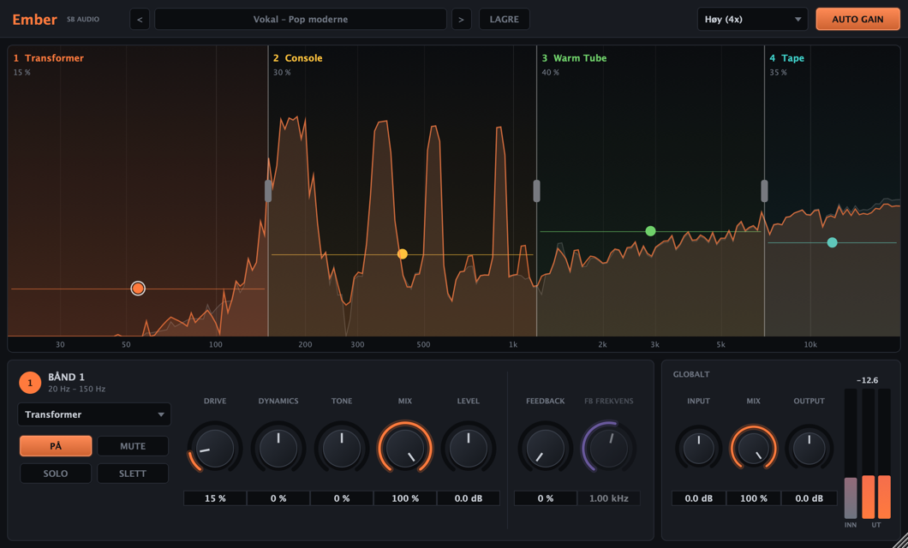

# Ember – multiband-metning

Ember er en Audio Unit / VST3-plugin for metning og forvrengning, inspirert av hvordan FabFilter Saturn 2 er bygget opp:
signalet deles i opptil **6 frekvensbånd**, og hvert bånd får sin egen metningstype, drive, dynamikk, tone,
tilbakekobling, mix og nivå. Slik kan du gi vokalen varme og tetthet i mellomtonen uten at bunnen blir grøtete eller
diskanten blir sprø. Presetene er laget for vokal.



## Visningen

Den store grafen viser spekteret inn (grått) og ut (oransje) og båndene som fargede felt.

| Handling | Hva skjer |
|---|---|
| **Dra opp/ned** i et bånd | Endrer Drive (Shift = fin justering). Scrollhjul gjør det samme. |
| **Dra en delelinje** | Flytter delefrekvensen mellom to bånd. |
| **Dobbeltklikk** i et bånd | Deler båndet i to der du klikker (begge halvdeler beholder innstillingene). |
| **Dobbeltklikk på en delelinje** | Slår sammen båndene på hver side. |
| **Høyreklikk** | Meny: type, på/mute/solo, del i to, slett. |

Klikk på et bånd for å redigere det i panelet under.

## Kontroller per bånd

| Kontroll | Hva den gjør |
|---|---|
| **Type** | Metningstypen, se listen under. |
| **Drive** | Hvor hardt båndet drives inn i metningen (0–100 %). 0 % er så godt som rent. |
| **Dynamics** | Positiv: gir tilbake dynamikken metningen tar (mer liv og transienter). Negativ: komprimerer ekstra (tettere og jevnere). |
| **Tone** | Mørkere (−) eller lysere (+) metning, vippet rundt midten av båndet (±6 dB). |
| **Mix** | Blanding av ren og mettet lyd i båndet (parallell metning). |
| **Level** | Utgangsnivå for båndet. Fungerer også som en enkel EQ. |
| **Feedback / FB frekvens** | Tilbakekobling rundt metningen ved en valgt frekvens: resonans og «ring». Høye verdier kan hyle. |
| **PÅ** | Av = båndet går rent gjennom (bypass). |
| **Mute / Solo** | Demp båndet, eller lytt bare på det. Solo lagres ikke. |
| **Slett** | Fjerner båndet. Nabobåndet tar over frekvensområdet. |

### Metningstyper

| Gruppe | Typer | Karakter |
|---|---|---|
| Tube | Clean Tube · Warm Tube · Smooth Tube | Myk, mest 2. harmoniske. Smooth Tube har en bias som følger nivået («sag»). |
| Tape | Tape · Hot Tape | Myk, symmetrisk metning med pre-/de-emfase. Diskanten mettes først og mykes litt opp med drive. |
| Transformer / Konsoll | Transformer · Console | Transformer mettes mest i bunnen (tetthet). Console er en subtil, «limende» kurve. |
| Clipping | Soft Clip · Hard Clip · Diode | Rett frem klipping. Diode er asymmetrisk. |
| Amp | Crunch Amp · Fuzz | Forsterkerforvrengning med filtrering før og etter. |
| Effekt | Rectify · Foldback · Lo-Fi · Breakup | Oktav, folding, bit- og sample-reduksjon og crossover-forvrengning. |

## Globale kontroller

| Kontroll | Hva den gjør |
|---|---|
| **Input** | Nivå inn i metningen. Mer input gir mer metning i alle bånd. |
| **Mix** | Global blanding av ren og mettet lyd. |
| **Output** | Utgangsnivå. |
| **Auto Gain** | Kompenserer for nivåøkningen fra Drive, så du hører karakteren og ikke bare volumet. Kalibrert for et typisk båndnivå (rundt −14 dBFS topp). Svakere partier blir litt sterkere og sterkere partier litt svakere, som ved ekte metning. |
| **Kvalitet** | Oversampling 2x / 4x / 8x. Høyere gir mindre aliasing (renere diskant ved mye drive), men bruker mer CPU. |
| **Meter** | Toppnivå inn og ut (L/R). |

Dobbeltklikk på en knapp setter den tilbake til standardverdien. Vinduet kan skaleres fra hjørnet nede til høyre.

## Presets

Velg i menyen øverst (eller bla med `<` `>`). Fabrikkpresetene vises også i Logics egen preset-meny.

- **Ett bånd:** Varm rørglød · Subtil tape-lim · Analog konsoll · Myk ballade · Parallell grit
- **Flerbånd:** Tetthet i mellomtonen · Luft og glans · Nærvær 2–5 kHz · Varm bunn, ren topp · De-harsh ·
  Pop moderne · Rap og hip-hop tett · Bakgrunnsvokal tykk · Rock-kant
- **Effekt:** Distort refreng · Megafon · Lo-fi radio · Spøkelsesresonans · Knust og ødelagt

Presetene er laget for et opptak som topper rundt −10 til −6 dBFS. Er sporet mye svakere eller sterkere, juster
**Input** først.

**Egne presets:** trykk **LAGRE** og gi et navn. De lagres i `~/Library/Audio/Presets/SB Audio/Ember/`.

## Bruk i Logic Pro

1. Sett **Ember** som insert på vokalsporet (*Audio Units → SB Audio → Ember*). Den passer gjerne etter EQ og
   kompressor (f.eks. PrismEQ → OptoTube → Ember).
2. Start med en preset og juster **Drive** i båndene til du hører nok karakter. Sammenlign med Logics bypass-knapp.
   Med Auto Gain på skal nivået være omtrent likt.
3. Bruk **Mix** (per bånd eller globalt) for parallell metning hvis det blir for mye.

## Bygge på Mac

Fra rotmappen (`SBAudio/`):

```bash
scripts/build.sh Ember
```

Se rotens `README.md` for krav og detaljer.

## Teknisk

- Hele kjeden går oversamplet (polyfase-IIR, 2x/4x/8x). Latensen er 4–6 samples og rapporteres til Logic.
- Delefilter: Linkwitz-Riley 24 dB/okt. De lavere båndene går gjennom all-pass-filtre, så summen er
  amplitude-flat. Målt: 6 bånd i bypass gir ±0,000 dB fra 30 Hz til 15 kHz.
- Når du endrer antall bånd, type eller kvalitet, krysstones det mykt, så det ikke klikker.
- Auto Gain er en fast kompensasjonstabell per type og drive, ikke en dynamisk nivåregulering. Derfor pumper den ikke.
- CPU (Apple Silicon, 6 aktive bånd, stereo, 48 kHz): ca. 6 / 12 / 24 % av én kjerne ved 2x / 4x / 8x.
  Ett bånd bruker langt mindre.
- Kilde: `Source/SaturationDsp.h` (DSP), `Source/PluginProcessor.*` (parametere, båndoperasjoner),
  `Source/PluginEditor.*` (GUI), `Source/FactoryPresets.h` (presets).

FabFilter og Saturn er varemerker for FabFilter. Ember er en egen konstruksjon og ingen kopi eller modellering av
noe bestemt produkt.

JUCE er lisensiert under AGPLv3 / JUCE-lisens (gratis for personlig bruk under omsetningsgrensen).
