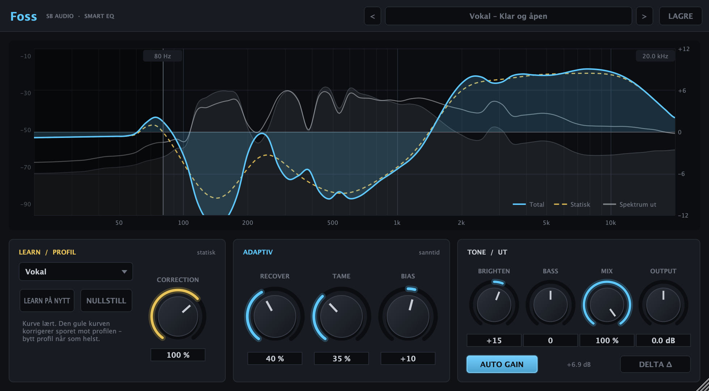

# Foss – smart EQ for tonal balanse

Foss er en Audio Unit / VST3-plugin som retter opp tonal balanse automatisk. Den kombinerer to tilnærminger:

- **Learn + profil** (som sonible smart:EQ): Foss lytter på sporet i noen sekunder, sammenligner det med en målprofil
  (vokal, akustisk gitar, tale, mix …) og lager en jevn, *statisk* korreksjonskurve.
- **Adaptiv sanntids-EQ** (som Soundtheory Gullfoss): **Recover**, **Tame**, **Bias** og **Brighten** endrer EQ-en
  fortløpende, mange ganger i sekundet. Foss løfter det som er maskert og demper det som stikker ut akkurat nå.

Learn tar seg av den grove balansen. Det adaptive laget rydder i detaljene mens musikken spiller. Begge kan brukes
hver for seg.



## Kom i gang

1. Sett **Foss** som insert på sporet (*Audio Units → SB Audio → Foss*).
2. Velg en preset som passer kilden, f.eks. *Vokal – Klar og åpen*.
3. Velg **profil**, start avspilling av et typisk parti og trykk **LEARN**. Etter 10 sekunder med lyd vises den gule
   korreksjonskurven. Pauser telles ikke med.
4. Juster **Recover** og **Tame** etter smak. Med **Auto gain** på hører du forskjellen i balanse, ikke i nivå.
5. Begrens gjerne frekvensområdet: dra de loddrette strekene i grafen. På vokal er 70–100 Hz nede vanlig.

## Kontroller

### Learn / profil (statisk)

| Kontroll | Hva den gjør |
|---|---|
| **Profil** | Målkurven Learn sammenligner med: *Universell*, *Vokal*, *Akustisk gitar*, *Tale* eller *Mix / master*. Du kan bytte profil etter at Foss har lært. Kurven regnes ut på nytt med en gang. |
| **LEARN** | Lytter i 10 s og lager korreksjonskurven. Trykk igjen for å stoppe tidligere (minst 2 s). |
| **Nullstill** | Fjerner den lærte kurven. |
| **Correction** | Hvor mye av korreksjonen som brukes (0–150 %). |

Den lærte kurven lagres i Logic-prosjektet. Den beholdes når du bytter preset, fordi den hører til sporet og ikke
til lyden i presetet.

### Adaptiv (sanntid)

| Kontroll | Hva den gjør |
|---|---|
| **Recover** | Løfter frekvenser som ligger under nabofrekvensene, typisk detaljer som er maskert. Støy og stillhet løftes aldri. Maks +9 dB. |
| **Tame** | Demper frekvenser som stikker ut akkurat nå: resonanser, harde toner og områder som dominerer. Maks −12 dB. |
| **Bias** | Fordeler arbeidet mellom Recover og Tame. − = mer temming, + = mer løft. |

### Tone / ut

| Kontroll | Hva den gjør |
|---|---|
| **Brighten** | Vipper hele balansen lysere (+) eller mørkere (−) rundt 1 kHz, med opptil 1 dB per oktav. |
| **Bass** | Mer eller mindre bunn under ca. 120 Hz (±6 dB). |
| **Mix** | Blanding av behandlet og ubehandlet signal. Blandingen er fasekorrekt. |
| **Output** | Utgangsnivå (±18 dB). |
| **Auto gain** | Holder opplevd lydstyrke lik. Tallet ved siden av viser hvor mye Foss kompenserer. |
| **Delta Δ** | Lytt bare på det Foss endrer. Nyttig for å høre om den tar noe du vil beholde. |
| **Frekvensområde** | Dra strekene i grafen (20 Hz – 2 kHz nede, 1–20 kHz oppe). Learn-korreksjonen og det adaptive laget virker bare innenfor området. Dobbeltklikk på en strek for å nullstille den. |

Grafen viser:

- Grått: spektrum inn (fylt) og ut (strek).
- Gult, stiplet: den statiske kurven (Learn + Brighten + Bass).
- Blått: den totale kurven som brukes akkurat nå, uten auto gain.

Dobbeltklikk på en knapp for å sette den tilbake til standard. Vinduet kan skaleres fra hjørnet nede til høyre.

## Presets

Velg i menyen øverst (eller bla med `<` `>`). Fabrikkpresetene vises også i Logics egen preset-meny. Presetene endrer
ikke den lærte kurven, så trykk LEARN på hvert spor.

- **Vokal:** Klar og åpen · Tem harde toner · Varm og nær · Fram i miksen · Bare learn (statisk)
- **Akustisk gitar:** Naturlig balanse · Glans og luft · Tem boom og klang · Bakgrunn i miks
- **Tale:** Podkast · Rydd opp i rom
- **Mix / master:** Lett touch · Balanse · Åpne toppen · Rydd i mellomtonen

**Egne presets:** trykk **LAGRE** og gi et navn. De lagres i `~/Library/Audio/Presets/SB Audio/Foss/`.

## Tips for Logic Pro

- Foss har **latens** (2048 samples ved 44,1/48 kHz, ca. 43 ms). Logic kompenserer for den automatisk ved miksing.
  Ved innspilling gjennom pluginen: slå den av, eller bruk *Low Latency Mode*.
- Bruk gjerne Foss **etter** en EQ som fjerner det du vet du ikke vil ha (f.eks. rumling), og **før** kompressoren.
- På master/bus: start med *Mix – Lett touch* og lav Correction. Små verdier gir mest.
- Learn stopper av seg selv etter 10 sekunder med lyd. Start derfor avspillingen i et parti som er typisk for sporet,
  f.eks. refrenget.

## Bygge på Mac

Fra rotmappen (`SBAudio/`):

```bash
scripts/build.sh Foss
```

Se rotens `README.md` for krav og detaljer.

## Teknisk

- STFT med sqrt-Hann-vindu og 75 % overlapp (FFT 2048 ved ≤ 48 kHz, 4096 ved 88/96 kHz, 8192 over det). Med alle
  kontroller i null er utgangen identisk med inngangen (null-test bedre enn −130 dB).
- Analysen samler spekteret i 64 bånd fra 20 Hz til 20 kHz (ca. 1/6 oktav). Rosa støy vises flatt.
- Stereo er lenket: begge kanaler får samme kurve, så stereobildet ikke flytter seg. Mono støttes.
- **Adaptivt lag:** en rask konvolutt per bånd (12 ms attack / 100 ms release) sammenlignes med en utglattet
  spektralkonvolutt (ca. 0,6 oktav). Bånd under konvolutten løftes (Recover) og bånd over dempes (Tame). En port
  hindrer at støy og stillhet løftes. Kurven glattes over frekvens og tid: kutt går raskere enn løft.
- **Learn:** gjennomsnittlig spektrum over rammer med signal, sammenlignet med profilen. Nivået normaliseres mellom
  100 Hz og 8 kHz. Bånd uten innhold løftes ikke. Korreksjonen begrenses til −12/+8 dB og glattes (ca. 1/3 oktav).
- All gain er reell og jevn over frekvens, så EQ-en er nullfase. Mix og Delta regnes ut i frekvensdomenet og er derfor
  fasekorrekte.
- Auto gain sammenligner nivå før og etter med en enkel lydstyrkevekting (mindre vekt på dyp bass og ekstrem diskant).
- Bypass i Logic går gjennom samme vei med gain 1, så latensen er lik også når pluginen er bypasset.
- CPU: ca. 0,3 % av én kjerne (Apple Silicon, stereo, 48 kHz).
- Kilde: `Source/SmartEqEngine.h` (DSP), `Source/PluginProcessor.*` (parametere, Learn-tilstand),
  `Source/PluginEditor.*` (GUI), `Source/FactoryPresets.h` (presets).

sonible, smart:EQ, Soundtheory og Gullfoss er varemerker for sine respektive eiere. Foss er en egen konstruksjon og
ingen kopi av noe bestemt produkt.

JUCE er lisensiert under AGPLv3 / JUCE-lisens (gratis for personlig bruk under omsetningsgrensen).
