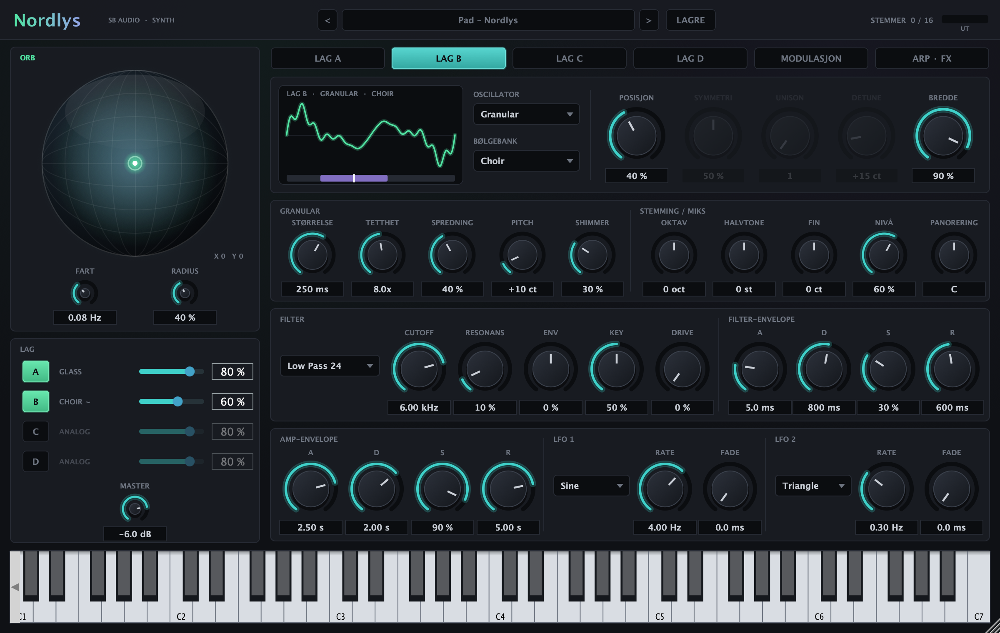

# Nordlys – atmosfærisk synth

Nordlys er en Audio Unit / VST3-**synth** (instrument) for Logic Pro, inspirert av måten store «atmosfære-synther»
som Spectrasonics Omnisphere er bygget opp: flere lag som spilles samtidig, granulær syntese, en XY-kule som former
lyden mens du spiller, en fleksibel modulasjonsmatrise, arpeggiator og innebygde effekter.
Alle lyder lages i sanntid – det følger ikke med noe sample-bibliotek, så pluginen er liten og laster raskt.



## Oppbygging

```
 Tone inn ─▶ Arpeggiator ─▶ 16 stemmer × 4 lag (A–D) ─▶ Chorus ─▶ Delay ─▶ Reverb ─▶ Master
                                │
            Lag: Oscillator ─▶ Drive ─▶ Filter ─▶ Amp-envelope ─▶ Nivå / Pan
                 (+ filter-envelope og to LFO-er per lag)
```

### Lag A–D

Hvert lag er en komplett synth. Slå lag av/på med **A B C D** til venstre; skyveren ved siden av er lagets nivå.
Velg fanen **LAG A … LAG D** for å redigere laget.

| Del | Kontroller |
|---|---|
| **Oscillator** | **Analog** (sinus → trekant → sag → firkant), **Wavetable** (morfer gjennom en bølgebank), **FM** (to operatorer), **Granular** (mange små korn hentet fra bølgebanken) og **Noise** (farget støy). |
| **Bølgebank** | Analog, Glass, Choir (vokaler a–o–u–e–i), Strings, Organ, Digital, Air, Metal. Brukes av Wavetable og Granular. |
| **Form / Posisjon** | Analog: bølgeform. Wavetable/Granular: posisjon i banken. FM: modulasjonsmengde. Noise: farge. |
| **Symmetri / Ratio** | Bøyer bølgeformen (50 % = uendret). I FM-modus: frekvensforholdet mellom operatorene (0,5:1 – 8:1). |
| **Unison / Detune / Bredde** | Opptil 7 stemmer per tone, stemt fra hverandre og spredt i stereo. |
| **Granular** | **Størrelse** (kornlengde), **Tetthet** (antall overlappende korn), **Spredning** (hvor i banken kornene hentes), **Pitch** (tilfeldig tonehøyde per korn) og **Shimmer** (andel korn en oktav/kvint over – gir glitrende tekstur). |
| **Stemming / miks** | Oktav, halvtone, fin, nivå og panorering. |
| **Filter** | Low Pass 24/12, Band Pass, High Pass, Notch eller Off. Cutoff, resonans, envelope-mengde (±), key tracking og drive. |
| **Envelopes** | Egen ADSR for filter og amp. |
| **LFO 1 / LFO 2** | Sine, Triangle, Saw, Square, S&H og Drift (myk tilfeldig bevegelse). **Fade** gir forsinket LFO, f.eks. vibrato som kommer inn etter tonen. LFO-ene kobles til mål i modulasjonsmatrisen. |

### Orb

Den glødende kula øverst til venstre er en XY-kontroll med to modulasjonskilder: **Orb X** og **Orb Y**.
Dra punktet for å endre lyden mens du spiller (Logic kan automatisere begge). Med **Fart** og **Radius** sirkler
Orb automatisk rundt punktet, så lyden beveger seg av seg selv. Dobbeltklikk setter punktet i midten.
Hva Orb gjør bestemmes i modulasjonsmatrisen – fabrikk-presetene har allerede koblet den til noe som høres.

### Modulasjon

Åtte spor: **Kilde × Via × Mengde → Mål**, for alle lag eller ett bestemt lag.

- **Kilder:** LFO 1, LFO 2, Filter Env, Amp Env, Mod Wheel, Velocity, Aftertouch, Key, Random, Orb X, Orb Y.
- **Via:** skalerer mengden med en annen kilde – f.eks. *LFO 1 → Fine via Mod Wheel* = vibrato bare når modhjulet er oppe.
- **Mål:** Pitch, Fine, Cutoff, Resonance, Level, Pan, Shape, Symmetry, Grain Size, Grain Density, Detune, LFO 1/2 Rate.

### Arp · FX

| Del | Kontroller |
|---|---|
| **Arpeggiator** | Up, Down, Up/Down, Random, As Played og Chord. Rate 1/1–1/32 (med trioler), 1–4 oktaver og gate. Følger Logics tempo og takt. Sustain-pedalen holder akkorden. |
| **Chorus** | Mix, rate, dybde. |
| **Delay** | Ping-pong, tempo-synket (1/32 – 1/2, prikket og triol), feedback og tone. |
| **Reverb** | Samme reverb-motor som Aura: Ambience, Room, Chamber, Hall, Plate, Vintage. Mix, decay og tone. |
| **Spillemåte** | **Poly** (16 stemmer), **Mono** eller **Legato**, glide (portamento), pitch bend-område og velocity-følsomhet. |

Dobbeltklikk på en knapp setter den tilbake til standardverdien; dobbeltklikk på en verdi for å skrive inn et tall.
Vinduet kan skaleres fra hjørnet nede til høyre. Klaviaturet nederst kan spilles med musa.

## Presets

Velg i menyen øverst (eller bla med `<` `>`). Fabrikk-presets vises også i Logics egen preset-meny.

**Pads:** Nordlys · Varm analog · Glassmorgen · Kor i katedral · Dyp drone
**Teksturer:** Granulær vind · Skimrende stjerner · Digitalt hav · Atmosfære – Fjern tone
**Keys:** Elektrisk piano · Glassklokker · Orgel · Strings – Ensemble · Pluck – Harpe i tåke
**Bass:** Sub og knurr · Wobble
**Lead:** Nordlys-lead · Synkron kvadrat
**Arp:** Krystallpuls · Analog sekvens

Prøv **modhjulet** og **Orb** på alle presetene – de fleste er koblet til noe.

**Egne presets:** trykk **LAGRE** og gi et navn. De lagres som filer i
`~/Library/Audio/Presets/SB Audio/Nordlys/` og kan kopieres mellom maskiner.

## Bruk i Logic Pro

1. Lag et nytt **Software Instrument**-spor og velg *AU Instruments → SB Audio → Nordlys*.
2. Velg en preset og spill. Dra i Orb eller bruk modhjulet for å få lyden til å bevege seg.
3. For arp-presetene: trykk Play i Logic – arpeggiatoren følger prosjektets tempo.
4. Automatisering: alle kontroller (også Orb X/Y) kan automatiseres fra Logic.

## Bygge på Mac

Fra rotmappen (`SBAudio/`):

```bash
scripts/build.sh Nordlys
```

Se rotens `README.md` for krav og detaljer. Hvis Logic ikke viser pluginen:
*Logic Pro → Settings → Plug-in Manager → Reset & Rescan Selection*.

## Teknisk

- AU-type `aumu` (instrument), stereo ut, ingen latens. 16 stemmer polyfoni, sample-nøyaktig MIDI og arp.
- Wavetables lages prosedyralt ved oppstart (invers FFT) med båndbegrensede versjoner per oktav, så høye toner
  ikke aliaserer. Granulær syntese leser korn (Hann-vindu) fra de samme bankene.
- Filter: TPT state variable (Zavalishin/Simper), 24 dB = to kaskaderte trinn. Modulasjon oppdateres hver 16. sample,
  oscillatorer, filter og envelopes per sample.
- Kilde: `Source/SynthEngine.h` (stemmer, lag, modulasjon, arp, effekter), `Source/Wavetables.h` (bølgebanker),
  `Source/Params.h` (parameter-ID-er og lister), `Source/PluginProcessor.*`, `Source/PluginEditor.*` (GUI),
  `Source/FactoryPresets.h`. Reverb og preset-håndtering ligger i `shared/sbaudio_common`.
- Parameter-ID-er og rekkefølgen i alle valglister må aldri endres (lagrede Logic-prosjekter) – bare legg til på slutten.

Omnisphere og Spectrasonics er varemerker for sine respektive eiere. Nordlys er en egen konstruksjon inspirert av
den generelle oppbygningen til slike synther; den bruker ingen lyder, kode eller grafikk fra dem.

JUCE er lisensiert under AGPLv3 / JUCE-lisens (gratis for personlig bruk under omsetningsgrensen).
