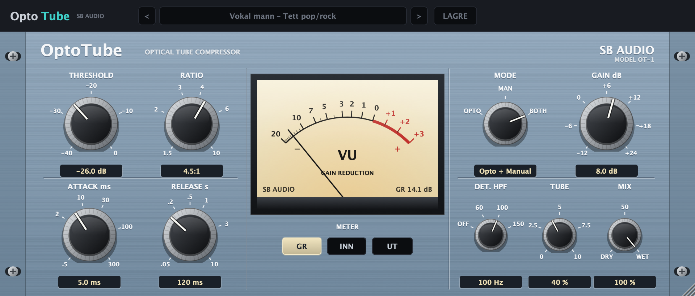

# OptoTube – opto/rør-kompressor

OptoTube er en Audio Unit / VST3-kompressor for vokal og akustisk gitar. Den kombinerer to klassikere:
den myke, programavhengige **optiske** kompresjonen fra en LA-2A og den fleksible **rør-kompressoren** med
manuell attack/release fra en Tube-Tech CL 1B. Utseendet er inspirert av CL 1B: stålblått rack-panel,
svarte knapper med skala og et stort VU-meter i midten. Ingen sidechain – detektoren lytter bare på sporet selv.



## Kontroller

| Kontroll | Hva den gjør |
|---|---|
| **Threshold** | Nivået der kompresjonen starter (tilsvarer *Peak Reduction* på LA-2A). Lavere = mer kompresjon. Måles mot toppnivå (dBFS). |
| **Ratio** | 1,5:1 – 10:1. 2–4 er typisk for vokal og gitar, 8–10 nærmer seg limiting. Myk knekk (soft knee). |
| **Mode** | **OPTO**: LA-2A-stil. Attack og release styres automatisk av signalet (se under), Attack/Release-knappene dimmes. **MAN**: CL 1B-stil, attack og release som du stiller dem. **BOTH**: begge kjører parallelt og den som demper mest vinner – den manuelle fanger raske topper, opto-delen rir nivået. Tilsvarer *Fixed + Manual* på CL 1B. |
| **Attack** | 0,5–300 ms (MAN og BOTH). Lengre attack slipper anslaget gjennom – fint på akustisk gitar. |
| **Release** | 50 ms – 10 s (MAN og BOTH). |
| **Det. HPF** | Filtrerer bassen bort fra *detektoren* (ikke fra lyden): Off / 60 / 100 / 150 Hz. Hindrer pumping fra proximity-effekt, plopp og gitarkroppens boom. |
| **Tube** | Rørkarakter 0–10: myk, asymmetrisk metning med mest 2. harmoniske. 0 = helt rent. |
| **Gain** | Make-up gain på det komprimerte signalet (−12 til +24 dB). |
| **Mix** | Parallellkompresjon: DRY = ukomprimert, WET = bare komprimert. |
| **Meter** | VU-meteret viser **GR** (gain reduction), **INN** eller **UT** (0 VU = −18 dBFS RMS). Nede til høyre i meteret står verdien i tall. |

Dobbeltklikk på en knapp setter den tilbake til standardverdien. Vinduet kan skaleres fra hjørnet nede til høyre.

### Opto-modus i detalj

Som i en optisk celle er attack rundt 10 ms, men raskere ved store nivåhopp. Releasen går i to trinn: omtrent
halvparten av dempingen slipper på ~60 ms, resten sakte (0,4–3 s). Jo lenger og hardere signalet har vært
komprimert, desto tregere blir den siste delen (cellens «minne»). Målt: etter et kort støt er dempingen nesten borte
etter 2 s, etter 5 s hard kompresjon er det fortsatt ~2,5 dB igjen etter 2 s. Det gir den jevne, «usynlige»
kompresjonen LA-2A er kjent for på vokal.

## Presets

Velg i menyen øverst (eller bla med `<` `>`). Fabrikk-presets vises også i Logics egen preset-meny.

**Vokal (mann):** Jevn og varm · Tett pop/rock · Myk ballade · Lead med kant · Rap og tale · Parallell tykkelse · Nær og intim
**Akustisk gitar:** Fingerspill naturlig · Strumming jevn · Varm opto · Bakgrunn i miks · Parallell glans · Perkusjon og anslag

Presetene forutsetter et opptak som topper rundt −10 til −6 dBFS. Er sporet ditt mye svakere eller sterkere, juster
**Threshold** først (sikt mot 3–6 dB GR i de kraftigste partiene), deretter **Gain**.

**Egne presets:** trykk **LAGRE** og gi et navn. De lagres som filer i
`~/Library/Audio/Presets/SB Audio/OptoTube/` og kan kopieres mellom maskiner. Fra menyen kan du også slette egne
presets og åpne mappen i Finder.

## Bruk i Logic Pro

1. Sett **OptoTube** som insert på vokal- eller gitarsporet (*Audio Units → SB Audio → OptoTube*), gjerne etter EQ
   (f.eks. PrismEQ) og etter VoxPilot på vokal.
2. Start med en preset, spill av den mest intense delen og still **Threshold** til VU-meteret viser 3–6 dB GR.
3. Bruk **Gain** så nivået ut er omtrent som med pluginen av (sammenlign med Logics bypass-knapp).
4. Skru **Tube** opp for mer varme og tetthet, og **Mix** ned for parallellkompresjon.

## Bygge på Mac

Fra rotmappen (`SBAudio/`):

```bash
scripts/build.sh OptoTube
```

Se rotens `README.md` for krav og detaljer. Hvis Logic ikke viser pluginen:
*Logic Pro → Settings → Plug-in Manager → Reset & Rescan Selection*.

## Teknisk

- Null latens (egnet ved innspilling). Mono og stereo; stereo er alltid linket (samme demping på begge kanaler).
- Detektor: RMS (~4 ms) over begge kanaler, kalibrert mot toppnivå for sinus. Gain-kurve med myk knekk
  (10 dB i opto, 6 dB i manuell). Ballistikk i dB-domenet.
- Rørtrinn: asymmetrisk `tanh` med enhetsforsterkning for svake signaler, DC-blokker etter.
- Kilde: `Source/CompressorEngine.h` (DSP), `Source/PluginProcessor.*` (parametere, metere),
  `Source/PluginEditor.*` (GUI), `Source/FactoryPresets.h` (fabrikk-presets). Preset-håndteringen ligger i
  `shared/sbaudio_common` (`sbaudio::PresetManager`, `sbaudio::PresetBar`).

LA-2A, Tube-Tech og CL 1B er varemerker for sine respektive eiere. OptoTube er en egen konstruksjon inspirert av
hvordan slike kompressorer oppfører seg; den er ikke en kopi eller modellering av noen bestemt maskinvare.

JUCE er lisensiert under AGPLv3 / JUCE-lisens (gratis for personlig bruk under omsetningsgrensen).
