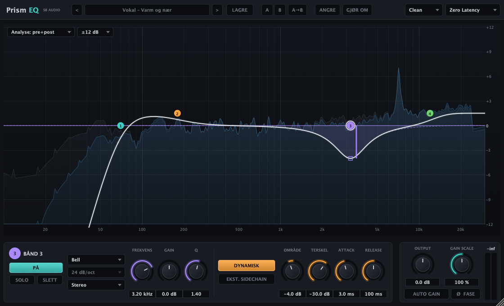

# PrismEQ – dynamisk parametrisk EQ

PrismEQ er en Audio Unit / VST3-equalizer i samme klasse som FabFilter Pro-Q 4, laget for å være enkel å bruke:
du jobber direkte i den store grafen, og alt du trenger for vokal og akustisk gitar ligger i fabrikk-presetene.



## Funksjoner

| Funksjon | Detaljer |
|---|---|
| **24 bånd** | Bell, Low Shelf, Low Cut, High Shelf, High Cut, Notch, Band Pass, Tilt Shelf, Flat Tilt, All Pass. |
| **Helning (Low/High Cut)** | 6, 12, 18, 24, 30, 36, 48, 72 og 96 dB/oktav. Q styrer resonansen ved knekkpunktet. |
| **Dynamisk EQ** | På Bell, shelf og Tilt Shelf. Område (±30 dB), terskel, attack og release. Negativt område = demper når båndet blir for kraftig (de-essing, boom), positivt = løfter. |
| **Ekstern sidechain** | Per bånd: et dynamisk bånd kan styres av et annet spor (f.eks. dempe gitaren der vokalen er). |
| **Stereoplassering** | Per bånd: Stereo, Left, Right, Mid eller Side. |
| **Zero Latency / Linear Phase** | Zero Latency for innspilling. Linear Phase gir ingen faseforskyvning (≈ 85 ms forsinkelse ved 44,1/48 kHz, Logic kompenserer automatisk). |
| **Character** | Clean, Subtle eller Warm – litt analog metning på utgangen. |
| **Analysator** | Spekter før og etter EQ (4,5 dB/okt tilt). **Spectrum Grab**: hold musen over en topp i spekteret og klikk for å lage et bånd der. |
| **Solo** | Hold inne SOLO for å høre bare området båndet jobber med. |
| **Auto Gain / Gain Scale** | Auto Gain holder opplevd nivå likt mens du EQ-er. Gain Scale skalerer alle bånd (0–200 %). |
| **Output** | Utgangsgain, polaritet (Ø) og nivåmåler med topphold. |
| **Angre / gjør om, A/B** | Angre (Cmd+Z) og gjør om (Cmd+Shift+Z). A/B-sammenligning med kopiering mellom A og B. |
| **Presets** | Fabrikk-presets for vokal og akustisk gitar, og egne presets. |

## Bruk i grafen

| Handling | Resultat |
|---|---|
| Dobbeltklikk på tom plass | Nytt Bell-bånd der du klikket (helt til venstre/høyre blir det Low Cut / High Cut). |
| Klikk på topp i spekteret | Nytt smalt bånd på den frekvensen – dra opp/ned for gain. |
| Dra en node | Frekvens og gain. **Shift** = finjuster, **Cmd** = bare gain. |
| Scrollhjul over node | Q (bredde). |
| Dobbeltklikk på node | Slå båndet av/på. |
| Alt-klikk på node / Delete-tasten | Slett båndet. |
| Høyreklikk på node | Meny: filtertype, helning, stereo, dynamisk, slett. |
| Dra den lille ruten under/over en dynamisk node | Dynamisk område. Den skraverte flaten viser hvor langt båndet kan bevege seg, og den tynne streken ved noden viser hva det gjør akkurat nå. |

Panelet nederst viser alle innstillinger for valgt bånd; verdiene kan også skrives inn (dobbeltklikk på tallet).
Skala (±3/6/12/30 dB) og analysator velges oppe til venstre i grafen.

## Presets

Presetmenyen (midt i toppfeltet, eller `<` / `>`) har to deler:

- **Fabrikk-presets** – startpunkter for vokal (*Ren og klar, Varm og nær, Luft og nærvær, De-esser, Proximity-kontroll,
  Telefon*) og akustisk gitar (*Klar og luftig, Slank i miks, Temme boom, Varm fingerspill, Plass til vokal (sidechain)*).
  De vises også i Logics egen preset-meny.
- **Mine presets** – trykk **LAGRE** for å lagre gjeldende innstilling. Filene ligger i
  `~/Library/Audio/Presets/SB Audio/PrismEQ/` (`.prismpreset`) og kan kopieres mellom maskiner.
  «Slett» flytter filen til papirkurven.

Logics egen *Save As…* i plugin-vinduet fungerer også som vanlig.

## Tips i Logic Pro

- **Vokal:** Start med *Vokal – Ren og klar*. Juster Low Cut til rett under stemmens grunntone, og still terskelen på
  de-esser-båndet (bånd 5) slik at det bare reagerer på s-lyder (se den tynne streken ved noden).
- **Akustisk gitar:** *Temme boom* demper rumling fra kroppsresonansen bare når den faktisk slår inn.
- **Sidechain:** I *Plass til vokal (sidechain)* velger du vokalsporet i *Side Chain*-menyen øverst i plugin-vinduet.
  Uten sidechain reagerer båndet på gitaren selv.
- Bruk **Zero Latency** mens du spiller inn, og gjerne **Linear Phase** når du mikser.

## Bygge på Mac

Fra rotmappen (`SBAudio/`):

```bash
scripts/build.sh PrismEQ
```

Hvis Logic ikke viser pluginen: *Logic Pro → Settings → Plug-in Manager → Reset & Rescan Selection*.

## Teknisk

- Hvert bånd er en kaskade av trapes-SVF-er (Cytomic) og TPT-enpolsfiltre. De tåler rask modulasjon, så parametre
  glattes og koeffisienter oppdateres hver 32. sample uten klikk. Grafen regner ut nøyaktig samme digitale respons som
  lyden bruker (verifisert mot sinusmålinger).
- Dynamikk: detektor med båndpass/lavpass/høypass på båndets frekvens, peak-envelope med attack/release og 6 dB myk knekk.
- Linear Phase: statiske bånd (Stereo/Mid/Side) samles til en FIR (8192 taps ved 44,1/48 kHz, Blackman-Harris-vindu)
  og kjøres i mid/side-domenet. Dynamiske bånd og Left/Right-bånd kjøres fortsatt minimum-fase etter FIR-en.
- Bånd som slås av/på eller endrer type, toner inn/ut over 20 ms.
- Kilde: `Source/EqDsp.h` (filterdesign), `Source/PluginProcessor.*` (lyd, lineær fase, angre/A/B),
  `Source/EqGraph.*` (grafen), `Source/PluginEditor.*` (panel), `Source/PresetManager.*` (presets).

### Ikke med (ennå) sammenlignet med Pro-Q 4

Spectral Dynamics, Natural Phase-modus, EQ Match, EQ Sketch, Instance List, valg av flere bånd samtidig,
brickwall-helning, pianovisning, MIDI Learn og surround/Atmos.
