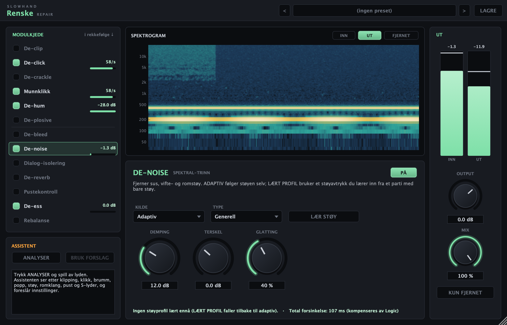

# Renske – reparasjon og opprydding

Renske er en Audio Unit / VST3-plugin for å reparere og rydde i opptak: klipping, klikk, knitring, munnlyder,
brumm, popp, lekkasje fra andre kilder, støy, romklang, pust og skarpe S-lyder. Den kan også endre balansen
mellom vokal, bass, perkusjon og resten i en ferdig miks. Alt ligger i én plugin som en fast **modulkjede**
der hver modul slås av og på for seg. En **assistent** lytter på lyden i 10 sekunder og foreslår hvilke
moduler som trengs, med innstillinger.



## Modulkjeden

Modulene kjøres i denne rekkefølgen (ovenfra og ned i vinduet). Klikk på navnet for å se kontrollene,
klikk på den runde knappen for å slå modulen av eller på. Til høyre i hver rad vises hvor mye modulen
jobber akkurat nå (reparasjoner per sekund, eller demping i dB).

### Tidsdomene

| Modul | Hva den gjør | Kontroller |
|---|---|---|
| **De-clip** | Tegner opp igjen bølgetopper som er kuttet av (digital klipping, overstyrt forforsterker). Korte klipp fylles med AR-interpolasjon, lange med en glatt kurve fra begge sider. | **Modus** (Auto finner klippenivået selv / Manuell), **Terskel** (bare Manuell), **Gain** (senker nivået etterpå så de gjenskapte toppene får plass) |
| **De-click** | Finner korte klikk og smell og fyller dem inn med lyd beregnet fra omgivelsene. | **Følsomhet**, **Bredde** (hvor lange klikk som repareres) |
| **De-crackle** | Fjerner tett, svak knitring (vinyl, dårlige kabler). | **Mengde** |
| **Munnklikk** | Fjerner smatting, tungeklikk og spytt i tale og vokal (korte, lyse klikk). | **Følsomhet**, **Bredde** |
| **De-hum** | Fjerner brumm fra strømnettet og overtonene med smale filtre. | **Grunntone** (Auto følger brummen / 50 Hz / 60 Hz), **Overtoner** (1–16), **Q**, **Dybde**, **Diskant-slakk** (mindre demping av høye overtoner), **Lavkutt** |
| **De-plosive** | Demper popp fra P og B og vindstøt. Bare bassen under delefrekvensen dempes, og bare når den plutselig tar over. | **Følsomhet**, **Frekvens**, **Maks demping** |

### Spektraltrinn

Disse modulene deler én FFT-analyse og brukes likt på begge kanaler, så stereobildet beholdes.

| Modul | Hva den gjør | Kontroller |
|---|---|---|
| **De-bleed** | Fjerner lekkasje fra en annen kilde, f.eks. klikkspor eller monitorlyd i vokalmikrofonen. Krever **sidechain** (se under). | **Mengde**, **Maks demping** |
| **De-noise** | Fjerner sus, vifte- og romstøy. | **Kilde** (Adaptiv følger støyen selv / Lært profil), **Type** (Generell / Tale / Gitar), **Demping**, **Terskel**, **Glatting**, knappen **LÆR STØY** |
| **Dialog-isolering** | Holder på stemmen og skrur ned alt annet. | **Separasjon**, **Bakgrunn** (hvor mye av bakgrunnen som blir igjen) |
| **De-reverb** | Demper romklang i opptaket. | **Mengde**, **Etterklang** (omtrent rommets RT60) |
| **Pustekontroll** | Finner innpust mellom fraser og senker dem. | **Følsomhet**, **Nivå** |
| **De-ess** | Demper skarpe S-, T- og SJ-lyder. | **Modus** (Spektral demper bare de skarpeste frekvensene / Klassisk demper hele området), **Terskel**, **Frekvens**, **Maks demping** |
| **Rebalanse** | Endrer nivået på vokal, bass, perkusjon og resten i en ferdig miks. Vokal finnes som det tonale i midten av stereobildet. | **Vokal**, **Bass**, **Perkusjon**, **Resten**, **Separasjon** |

### Utgang

| Kontroll | Hva den gjør |
|---|---|
| **Output** | Nivå ut etter hele kjeden. |
| **Mix** | Blander behandlet lyd med originalen. |
| **KUN FJERNET** | Lytt bare på det kjeden fjerner. Hører du stemme eller musikk her, er innstillingene for kraftige. |
| **Spektrogram** | Viser lyden **INN**, **UT** eller bare det som er **FJERNET**. |

Dobbeltklikk på en knapp setter den tilbake til standardverdien. Vinduet kan skaleres fra hjørnet nede til høyre.

## Assistenten

1. Trykk **ANALYSER** og spill av et typisk parti av sporet (analysen stopper selv etter 10 sekunder).
2. Assistenten ser etter klipping, klikk, knitring, munnlyder, brumm, popp, støy, romklang, pust og S-lyder
   og skriver hva den fant.
3. Trykk **BRUK FORSLAG**. Modulene den foreslår slås på med forslagene, resten slås av. Juster videre for hånd.

## Lære inn støy (De-noise)

1. Finn et parti med bare støy (før tellingen, mellom setninger).
2. Velg De-noise, trykk **LÆR STØY** mens partiet spilles, og trykk igjen (**STOPP**) etter 1–3 sekunder.
3. Kilde settes automatisk til **Lært profil**. Profilen lagres i Logic-prosjektet.

## De-bleed og sidechain i Logic Pro

1. Sett Renske på sporet med lekkasje (f.eks. vokalen) og slå på **De-bleed**.
2. Øverst i plugin-vinduet i Logic: velg sporet eller bussen som lekker inn (f.eks. klikksporet) i **Side Chain**-menyen.
3. Øk **Mengde** til lekkasjen forsvinner. Statuslinjen nederst i modulpanelet viser om sidechain-signalet mottas.

## Presets

Velg i menyen øverst (eller bla med `<` `>`). Fabrikk-presets vises også i Logics egen preset-meny.

**Tale:** Podkast-rens · Lett støyvask · Bråkete opptak · Mindre rom · Kirke og hall · Telefon og Zoom
**Vokal:** Munnlyder og pust · Popp og S · Klikkspor-lekkasje
**Gitar:** Forsterkersus og brumm · Akustisk rens
**Feil:** Brumm 50 Hz · Brumm 60 Hz · Klippet opptak · Digitale klikk
**Restaurering:** Vinyl – Lett · Vinyl – Gammel og slitt · Kassett – Sus
**Rebalanse:** Vokal ned (karaoke) · Bare vokal · Trommer ned · Vokal litt fram

Egne presets lagres med **LAGRE** i `~/Library/Audio/Presets/SB Audio/Renske/`.

## Bygge på Mac

Fra rotmappen (`SBAudio/`):

```bash
scripts/build.sh Renske
```

## Teknisk

- **Forsinkelse:** fast ~107 ms ved 44,1/48 kHz (2048 samples i klikktrinnet + 3072 i spektraltrinnet), uansett
  hvilke moduler som er på, så Logic kompenserer uten å måtte endre noe underveis. Ikke egnet for innspilling
  gjennom pluginen. Mono og stereo, valgfri sidechain.
- **De-clip / De-click / De-crackle / Munnklikk:** vinduer på 3 × 1024 samples. LPC (orden 24) med Levinson,
  deteksjon på prediksjonsfeilen mot en robust (median-basert) skala, reparasjon med minste kvadraters
  AR-interpolasjon (LSAR, båndet Cholesky). Klipp: AR-modell estimert bare fra uklippede samples, lange klipp
  fylles med kubisk tilpasning til begge sider, aldri innenfor klippnivået.
- **De-hum:** kaskade av smale peak-filtre på grunntonen og overtonene (samme bredde i Hz på alle).
  Auto-grunntone med Goertzel-skann rundt 50 og 60 Hz hvert halve sekund.
- **De-plosive:** komplementær deling ved delefrekvensen, rask demping av bassbåndet når det dominerer resten.
- **Spektraltrinn:** STFT 2048 (4096/8192 ved høyere samplerate), 75 % overlapp, sqrt-Hann, to rammer framoverblikk.
  Støygulv med minimumsstatistikk (glidende minimum over ~2 s, 25-persentil per 1/6 oktav så holdte toner ikke
  regnes som støy). De-noise: spektral subtraksjon med glatting i tid og frekvens. De-reverb: modell for sen
  etterklang (Lebart). Rebalanse: harmonisk/perkusiv separasjon med median-filtre + senter-ekstraksjon fra L/R.
- Kilde: `Source/RepairDsp.h` (all DSP), `Source/Modules.h` (parameter-ID-er og modulliste),
  `Source/PluginProcessor.*` (parametere, kjede, assistent, tilstand), `Source/PluginEditor.*` (GUI),
  `Source/FactoryPresets.h`.

### Begrensninger

Renske bruker klassisk signalbehandling, ikke trente nevrale nett. Dialog-isolering, Rebalanse og De-bleed fungerer
best når kilden er tydelig skilt fra resten (nivå, stereoplassering, tonalitet), og blir ikke like rene som
verktøy basert på maskinlæring. Renske er en effekt-plugin i sanntid – det finnes ingen egen lydeditor med
spektral redigering (markere og male bort lyder i spektrogrammet).

iZotope og RX er varemerker for sine eiere. Renske er en egen konstruksjon og ikke en kopi av noe annet produkt.

JUCE er lisensiert under AGPLv3 / JUCE-lisens (gratis for personlig bruk under omsetningsgrensen).
