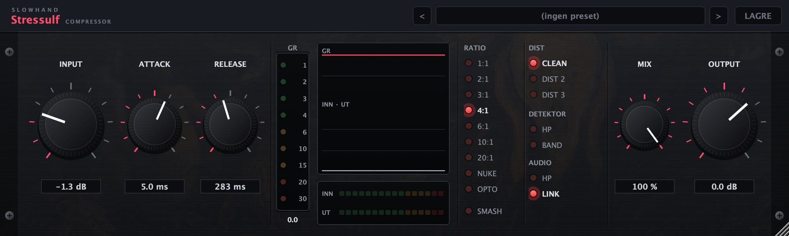

# Stressulf – karakterkompressor

Stressulf er en Audio Unit / VST3-kompressor som kan gå fra usynlig utjevning til full knusing. Den er inspirert av
hvordan klassiske «distortion-capable» studiokompressorer oppfører seg (à la Distressor). **Input** driver signalet
mot en fast terskel, og **Output** setter nivået ut. Ratioene går fra 1:1 til NUKE, og i tillegg finnes en
programavhengig OPTO-modus. Overtoner (Dist 2 / Dist 3) øker med kompresjonen.



## Kontroller

| Kontroll | Hva den gjør |
|---|---|
| **Ratio** | **1:1** gir ingen kompresjon, bare farge sammen med Dist. **2:1–6:1** har myk knekk, og knekken blir hardere jo høyere ratioen er. **10:1** og **20:1** begrenser. **NUKE** er nesten brickwall. **OPTO** har fast rask attack og en release som blir langsommere jo lenger den demper. |
| **SMASH** | Alle knapper inne: overkomprimerer (høyere inn gir lavere ut), med rask attack, kort release og ekstra forvrengning. Til romkanaler, trommebus og parallell knusing. |
| **Input** | Driver inn mot den faste terskelen (−20 dBFS topp). Mer input gir mer kompresjon og mer farge. |
| **Attack** | Fra 50 µs (fanger alt) til 30 ms (slipper anslaget gjennom). |
| **Release** | 50 ms – 3,5 s. Programavhengig: releasen blir opptil 3× langsommere når den demper lenge og mye. |
| **Clean / Dist 2 / Dist 3** | **Dist 2** gir like overtoner (rør-aktig, varm og tykk). **Dist 3** gir odde overtoner (tape-aktig, kant og bitt). Begge øker med kompresjonen. |
| **DET HP** | Detektoren lytter mindre på bassen, så den ikke pumper av basstromme og bass. |
| **BAND** | Detektoren lytter ekstra på 6 kHz og demper S-lyder og skarpe topper, som en de-esser. |
| **AUDIO HP** | Fjerner rumling under 80 Hz i selve lyden. |
| **LINK** | Stereo-link: begge kanaler dempes likt. |
| **Mix** | Parallellkompresjon. Det ukomprimerte signalet er fasekorrigert, så det oppstår ingen kamfiltrering. |
| **Output** | Utgangsnivå (−24 til +12 dB). Skru ned når du skrur opp Input. |

Grensesnittet er et lavt rack-panel i stil med originalen: knappene på rad, ratio og modus som LED-lister
(klikk på en rad for å velge), og en **GR**-LED-stige fra 1 til 30 dB. Skjermen i midten viser en **historikk** over
10 sekunder med demping (rød, øverst), nivå inn (grått felt) og nivå ut (hvit linje), med LED-metere for **INN** og **UT** under.
Med **SMASH** på lyser alle ratio-LED-ene, som på maskinvaren.
Dobbeltklikk på en knapp setter den tilbake til standardverdien. Vinduet kan skaleres fra hjørnet nede til høyre.

## Presets

Velg i menyen øverst eller bla med `<` `>`. Presetene vises også i Logics egen preset-meny.

- **Vokal:** Jevn lead · Pop foran i miksen · Rock med bitt · Myk opto · De-ess og jevn · Rap tett · Parallell knusing
- **Trommer:** Bus lim · Rom knust · Parallell smash · Skarptromme – Punch · Basstromme – Tett
- **Bass og gitar:** Bass – Jevn og varm · Bass – Tett DI · Akustisk gitar – Jevn strumming · Elgitar – Sustain · Synth – Pump
- **Farge og begrensning:** Bare varme (1:1 + Dist 2) · Tape-kant (1:1 + Dist 3) · Begrenser – Nuke

Presetene forutsetter et spor med topper rundt −10 til −6 dBFS. Er sporet mye svakere eller sterkere, juster
**Input** først og så **Output**. Egne presets lagres i `~/Library/Audio/Presets/SB Audio/Stressulf/`.

## Bruk i Logic Pro

1. Sett **Stressulf** som insert (*Audio Units → SLOWHAND → Stressulf*).
2. Velg ratio og skru opp **Input** til GR-meteret viser ønsket demping. Juster så **Output**.
3. **Attack** bestemmer hvor mye av anslaget som slipper gjennom, og **Release** hvor raskt den hviler.
4. For farge: velg **Dist 2** eller **Dist 3**. For bare farge uten kompresjon: **1:1** + Dist.
5. For parallell knusing: **SMASH** eller **NUKE**, mye Input og **Mix** på 25–40 %.

## Bygge på Mac

Fra rotmappen (`SBAudio/`):

```bash
scripts/build.sh Stressulf
```

## Teknisk

- Detektor i topp-domenet med logaritmisk attack/release. Myk knekk varierer med ratio. Fast terskel −20 dBFS.
- Programavhengig release ved hjelp av en langsom følger av dempingen. OPTO: release 60 ms + 120 ms per dB vedvarende demping.
- Forvrengning med stigning 1 rundt null, så svake signaler går rent gjennom. Asymmetrisk (Dist 2) eller symmetrisk (Dist 3)
  kurve, med DC-blokker.
- 2× oversampling (FIR, lineær fase) av detektor, gain og forvrengning. Latensen rapporteres til verten, og den tørre
  parallellveien forsinkes like mye.
- Kilde: `Source/StressulfEngine.h` (DSP), `Source/PluginProcessor.*` (parametere, metere), `Source/PluginEditor.*`
  (GUI), `Source/FactoryPresets.h`.

Distressor og Empirical Labs er varemerker for sine respektive eiere. Stressulf er en egen konstruksjon inspirert av
hvordan slikt utstyr oppfører seg; den er ikke en kopi eller modellering av noen bestemt maskinvare.
