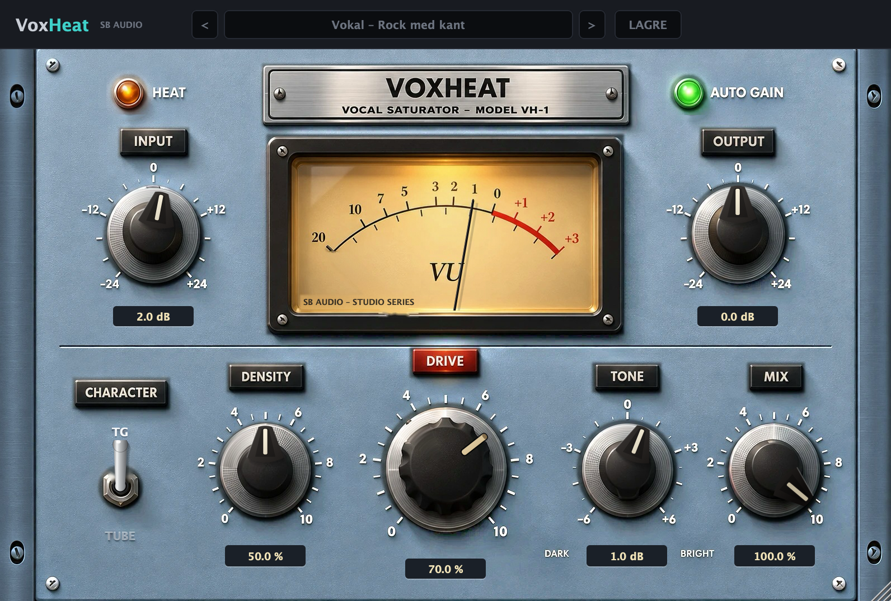

# VoxHeat – vokal-saturator

VoxHeat er en Audio Unit / VST3-saturator laget spesielt for vokal. Fargen er inspirert av to klassiske
britiske studiokjeder: **transistor-konsollen** (TG) og **rørforsterkeren** (Tube). Utseendet er et 60-talls
rack-panel i samme stålblå hardware-stil som OptoTube, med stort VU-meter, bakelittknotter og vippebryter.



## Kontroller

| Kontroll | Hva den gjør |
|---|---|
| **Input** | Nivå inn i metningen (−24 til +24 dB). Mer input = vokalen presses hardere inn i kurven. |
| **Drive** | Mengden metning. Den store knappen i midten. |
| **Character** | Vippebryter. **TG**: transistor/konsoll – framoverlent og tydelig, mest odde overtoner. **TUBE**: rør – rundere, varmere og fyldigere, mest like overtoner. Det aktive valget lyser. |
| **Density** | Kompander: komprimerer inn i metningen og ekspanderer etterpå. Svake og sterke stavelser får like mye farge, mens dynamikken beholdes. |
| **Tone** | Tilt-EQ etter metningen (−6 til +6 dB): mot venstre mørkere og mykere, mot høyre lysere med mer luft. |
| **Mix** | Blanding av tørt og mettet signal (parallell metning). Fasekorrigert, så ingen kamfiltrering. |
| **Output** | Utgangsnivå (−24 til +24 dB). |
| **Auto Gain** | Grønn lampe. Holder lydnivået omtrent likt når du endrer Drive, så du hører fargen – ikke bare mer volum. Klikk på lampen for å slå av/på. |
| **VU / Heat** | VU-meteret viser utgangsnivået (0 VU = −18 dBFS RMS). **HEAT**-lampen og meterets bakgrunnslys gløder sterkere jo mer metning som legges på. |

Dobbeltklikk på en knapp setter den tilbake til standardverdien; dobbeltklikk på en verdi for å skrive inn et tall.
Vinduet kan skaleres fra hjørnet nede til høyre.

### Laget for vokal

- **Sibilant-vern:** S-lyder (over ca. 5 kHz) sendes svakere inn i metningen og løftes igjen etterpå, så de ikke blir sprø.
- **Plosiv-vern:** frekvenser under 100 Hz går utenom metningen, så P- og B-lyder ikke blir grumsete.
- **4× oversampling** med lineær fase gir lite aliasing og rent parallellmiks.

## Presets

Velg i menyen øverst (eller bla med `<` `>`). Fabrikk-presets vises også i Logics egen preset-meny.

**Lead-vokal:** Varm og nær · Pop glans · Moderne pop, tett · Myk ballade · Soul og R&B · Rock med kant · Rap foran i miksen
**Stemmetype:** Mann – Dyp og varm · Mann – Presens og tyngde · Kvinne – Luftig · Kvinne – Fyldig rør
**Spesial:** Bakgrunnskor · Parallell tykkelse · Lo-fi radio · Tale og podkast – Klar

Presetene forutsetter et vokalopptak rundt −18 dBFS RMS (topper −10 til −6 dBFS). Er sporet mye svakere eller
sterkere, juster **Input** først. Med Auto Gain på er nivået ut omtrent som inn, så presetene kan sammenlignes direkte.

**Egne presets:** trykk **LAGRE** og gi et navn. De lagres som filer i
`~/Library/Audio/Presets/SB Audio/VoxHeat/` og kan kopieres mellom maskiner.

## Bruk i Logic Pro

1. Sett **VoxHeat** som insert på vokalsporet (*Audio Units → SB Audio → VoxHeat*), gjerne etter EQ og
   kompressor (f.eks. PrismEQ → OptoTube → VoxHeat).
2. Start med en preset og juster **Drive** til du hører fargen; HEAT-lampen viser hvor hardt det jobbes.
3. Bruk **Density** for jevnere farge gjennom frasene, **Tone** for å plassere vokalen (mørkere/lysere).
4. For parallell metning: skru Drive høyt og **Mix** ned til 30–50 %.

## Bygge på Mac

Fra rotmappen (`SBAudio/`):

```bash
scripts/build.sh VoxHeat
```

Se rotens `README.md` for krav og detaljer. Hvis Logic ikke viser pluginen:
*Logic Pro → Settings → Plug-in Manager → Reset & Rescan Selection*.

## Teknisk

- Latens ca. 61 samples (4× FIR-oversampling), rapporteres til verten og kompenseres automatisk. Mono og stereo.
- Signalvei: Input → 100 Hz-deling (lavt går rent forbi) → sibilant pre-emfase → kompander + metningskurve
  (oversamplet) → de-emfase → DC-blokker → Tone → Mix → Output.
- TG-kurve: hardere knekk med litt asymmetri. Tube-kurve: `tanh` med forspenning (mer 2. harmoniske).
  Bytte mellom dem krysstones uten klikk. Auto Gain normaliserer mot et nominelt vokalnivå.
- Kilde: `Source/PluginProcessor.*` (DSP, parametere, metere), `Source/PluginEditor.*` (GUI),
  `Source/FactoryPresets.h` (fabrikk-presets). Preset-håndteringen ligger i `shared/sbaudio_common`.
- Grafikk: `Assets/` lages av `artwork/make_assets.py` fra `artwork/source.png` (renser bort nål, pekere og
  verdier og farger panelet i SB Audio-stålblått). Kjør med Python 3 + `numpy` og `opencv-python-headless`:
  `python artwork/make_assets.py Assets artwork/source.png` fra `plugins/VoxHeat/`.

Abbey Road, EMI og Redd er varemerker for sine respektive eiere. VoxHeat er en egen konstruksjon inspirert av
hvordan slikt utstyr oppfører seg; den er ikke en kopi eller modellering av noen bestemt maskinvare.

JUCE er lisensiert under AGPLv3 / JUCE-lisens (gratis for personlig bruk under omsetningsgrensen).
