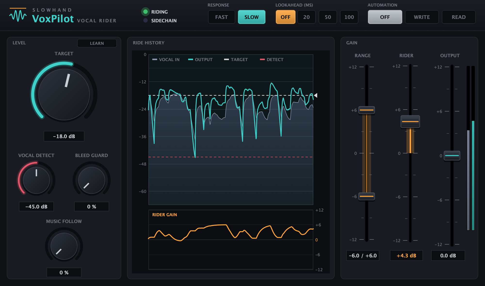

# VoxPilot – automatisk vokal-rider

VoxPilot er en Audio Unit / VST3-plugin som «rider» vokalfaderen for deg: den måler vokalnivået
kontinuerlig og justerer gainen mykt opp og ned slik at vokalen ligger jevnt rundt et målnivå –
**før** eventuell kompressor, uten å endre klangen. Bevegelsene kan skrives som automasjon i Logic.



## Kontroller

| Kontroll | Hva den gjør |
|---|---|
| **Learn** | Finner et utgangspunkt for innstillingene. Se *Learn* under. |
| **Target** | Ønsket vokalnivå (RMS, dBFS). Kan også dras direkte på den hvite stiplede linjen i grafen. |
| **Vocal Detect** | Terskel for hva som regnes som vokal. Under terskelen *fryser* rideren, så pust, støy og pauser ikke dras opp. Rød stiplet linje i grafen. |
| **Bleed Guard** | Hever detekteringsterskelen over lekkasje. Med sidechain: relativt til musikknivået (overhør i mikken ignoreres). Uten sidechain: relativt til et adaptivt støygulv. |
| **Music Follow** | Krever sidechain. Målnivået følger musikken: løfter vokalen i kraftige partier, senker i rolige (inntil ±6 dB). |
| **Fast / Slow** | Reaksjonstid. Slow = mykt og musikalsk (standard), Fast = tettere på ord/fraser. |
| **Lookahead (Off / 20 / 50 / 100 ms)** | Analysen ser fremover i lyden, så gainen allerede er riktig når en frase starter (ingen «for høy første stavelse»). Gir like mye forsinkelse – Logic kompenserer automatisk. Bruk **Off** ved live-bruk og innspilling, **50 ms** er et godt valg ved miksing. |
| **Range** | Hvor mye rideren maks får kutte (nedre håndtak) og løfte (øvre håndtak). |
| **Rider** | Viser gainen som brukes akkurat nå. I *Read*-modus kan den dras for hånd (dobbeltklikk = 0 dB). |
| **Output** | Utgangstrim etter rideren. |
| **Automation Off / Write / Read** | Se under. |

Statuslamper: **RIDING/IDLE** (vokal detektert) og **SIDECHAIN** (lyser når sidechain-signal mottas).
Grafen viser 10 sekunder historikk: vokal inn (grå), resultat ut (turkis), target, terskel og rider-gain (oransje).

## Learn

1. Trykk **LEARN** (øverst i LEVEL-panelet) og spill av en typisk vokalpassasje – gjerne refreng og vers.
2. VoxPilot lytter til den har hørt ca. 15 sekunder vokal (fremdriften vises over grafen), eller til du trykker
   **LEARNING** igjen for å avslutte tidligere.
3. Ut fra nivåfordelingen settes:
   - **Target** til vokalens typiske nivå (median), så rideren jevner ut frasene uten å endre totalnivået,
   - **Vocal Detect** mellom støy/pust-nivået og de svakeste frasene,
   - **Range** etter hvor mye nivået varierer (hvor langt de sterke frasene ligger over, og de svake under),
   - **Bleed Guard** etter hvor høyt støygulvet er (eller 30 % hvis sidechain er koblet til).

Resultatet vises over grafen. Det er et utgangspunkt – juster gjerne videre for hånd. Response, Lookahead, Music Follow
og Output endres ikke. Er det for lite vokal i opptaket, endres ingenting.

## Bruk i Logic Pro

1. Sett **VoxPilot** som første insert på vokalsporet (*Audio Units → SLOWHAND → VoxPilot*).
2. Trykk **LEARN** og spill av en vokalpassasje – eller still selv **Vocal Detect** like over støy-/pustenivået og **Target** der vokalen skal ligge.
3. Juster **Range** – f.eks. −6/+6 dB for normal bruk, større ved veldig ujevn vokal.
4. **Sidechain (valgfritt):** Lag en bus med musikken uten vokal (eller send fra instrumentbussen), og velg den i
   *Side Chain*-menyen øverst i plugin-vinduet. Da fungerer **Music Follow** og **Bleed Guard** mot musikken.

### Skrive automasjon («print» ridingen)

1. Sett sporets automasjonsmodus i Logic til **Latch** eller **Touch** (trykk `A` for å vise automasjon).
2. Trykk **WRITE** i VoxPilot og spill av sangen. Parameteren **Rider Gain** skrives som automasjon.
3. Trykk **READ** etterpå. Da spiller VoxPilot tilbake automasjonen (og ignorerer egen analyse) – du kan redigere
   kurven i Logic eller dra Rider-faderen for hånd.
4. **OFF** = live riding uten å røre automasjon.

## Bygge på Mac

VoxPilot ligger i SLOWHAND-samlingen. Fra rotmappen (`SBAudio/`):

```bash
scripts/build.sh VoxPilot
```

Se rotens `README.md` for krav og detaljer. Hvis Logic ikke viser pluginen:
*Logic Pro → Settings → Plug-in Manager → Reset & Rescan Selection*.

## Teknisk

- Null latens med Lookahead = Off – egnet live og under innspilling. Med lookahead forsinkes kun lydveien;
  detektoren ser signalet uforsinket, og ved starten av hver frase glir gainen raskt (innenfor lookahead-vinduet)
  til riktig nivå før lyden kommer. Latensen rapporteres til verten (plugin delay compensation).
  Målt på testsignal: avvik fra target de første 400 ms av en frase går fra ~6,7 dB (Off) til ~1,6 dB (50 ms).
- Deteksjon i stemmebåndet (HPF 110 Hz / LPF 7 kHz) med to detektorer: en langsom RMS for nivå og en rask for
  tilstedeværelse. Rideren beveger seg bare når begge er enige, slik at frasehaler og ansatser ikke pumpes.
- Gain glir i dB-domenet med egne tidskonstanter for opp/ned; gain-endringer påføres sample for sample.
- Kilde: `Source/RiderEngine.h` (DSP), `Source/PluginProcessor.*` (parametere, sidechain, automasjon),
  `Source/PluginEditor.*` (GUI).

JUCE er lisensiert under AGPLv3 / JUCE-lisens (gratis for personlig bruk under omsetningsgrensen).
